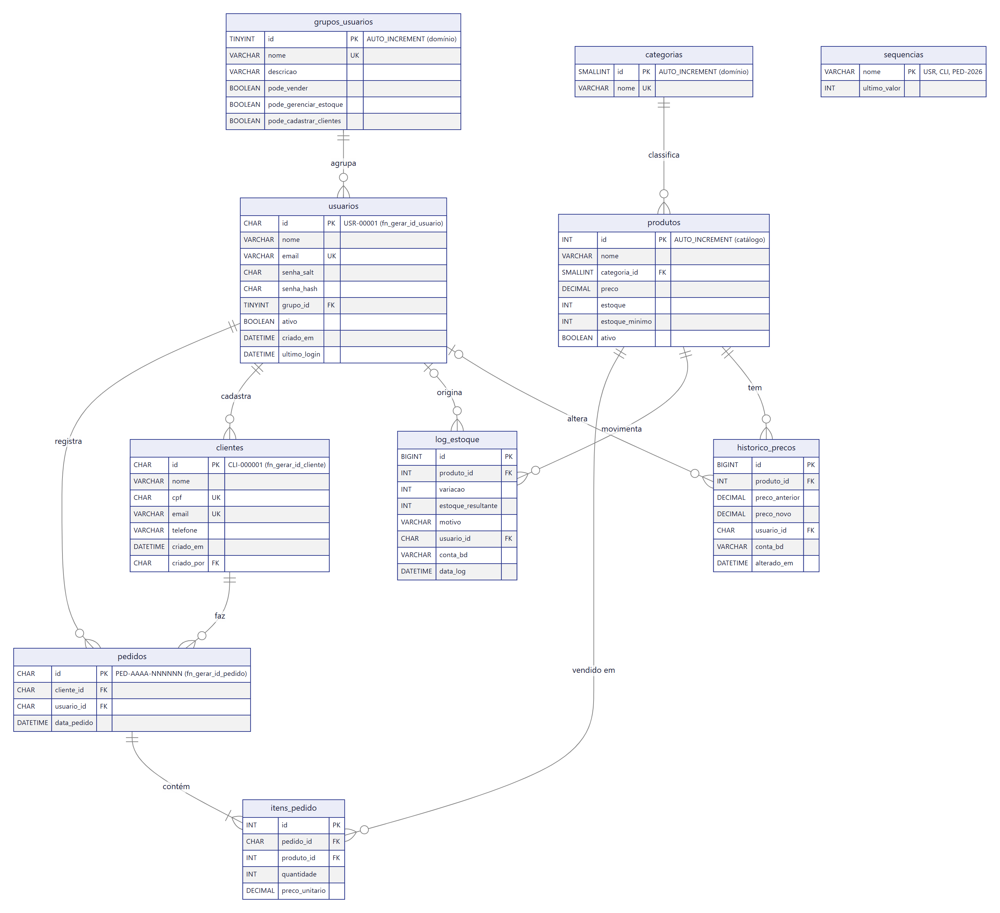

# LojaTech: regras de negócio, integridade e segurança implementadas no SGBD MySQL em um sistema de vendas e estoque

**Autores:** [Nome 1], [Nome 2], [Nome 3]
**Curso:** [Curso] — Universidade Católica de Brasília (UCB) · Disciplina: [Banco de Dados] · Prof.: [Nome]
**Repositório:** [link do GitHub]

---

## Resumo

Este trabalho apresenta o LojaTech, uma aplicação web de gestão de vendas e estoque cujo núcleo de regras de negócio está implementado no próprio Sistema Gerenciador de Banco de Dados (SGBD) MySQL 8. O projeto usa, de forma integrada, os principais recursos do SGBD:
- tabelas normalizadas com restrições de integridade (PK, FK, UNIQUE, CHECK);
- índices escolhidos a partir das consultas reais;
- seis triggers, seis views, nove functions e cinco stored procedures;
- controle transacional explícito (COMMIT, ROLLBACK e SAVEPOINT);
- geração própria de identificadores para dados críticos;
- controle de acesso por *roles*, com o princípio do menor privilégio;
- como recurso extra, um banco **NoSQL (MongoDB)** para fichas técnicas de esquema flexível e para o log de eventos.

A aplicação (Node.js/Express com HTML/CSS/JS) acessa o banco exclusivamente por uma conta sem nenhum privilégio de escrita direta em tabelas: toda alteração passa por *procedures*. Os resultados mostram que concentrar as regras no SGBD garante consistência mesmo diante de acessos concorrentes ou fora da aplicação. Isso foi verificado por 31 testes automatizados, 26 deles de ponta a ponta.

**Palavras-chave:** MySQL; MongoDB; persistência poliglota; stored procedures; triggers; transações; controle de acesso.

## 1. Introdução

Pequenos comércios dependem de dados de vendas e estoque corretos. Os erros mais comuns têm consequências financeiras diretas:
- vender um produto que não existe em estoque;
- dois pedidos com o mesmo número;
- alteração de preço sem rastro;
- um funcionário com acesso indevido a dados pessoais de clientes.

Quando essas regras ficam apenas no código da aplicação, qualquer acesso que não passe por ela as ignora: um script, outro sistema ou um erro de programação.

O LojaTech adota a abordagem oposta: **o banco de dados é o guardião das regras**. A aplicação web é uma camada de apresentação e validação de entrada. Integridade, atomicidade, auditoria e autorização são garantidas pelo MySQL.

## 2. Objetivos

**Objetivo geral:** desenvolver uma aplicação completa, com frontend, backend e banco relacional MySQL, que demonstre o domínio dos recursos de um SGBD.

**Objetivos específicos:**
1. Modelar o banco em 3FN, com relacionamentos e restrições declarativas.
2. Criar e justificar índices a partir das consultas da aplicação, medindo-os com `EXPLAIN`.
3. Implementar triggers, views, procedures e functions com finalidade clara.
4. Garantir atomicidade das operações com controle transacional (TCL).
5. Gerar identificadores próprios para dados críticos, sem lacunas e seguros em concorrência.
6. Definir contas e *roles* com privilégios mínimos, sem uso do `root` pela aplicação.
7. Exibir na interface dados de entidades e de views, com validação de ponta a ponta.

## 3. Metodologia

O desenvolvimento seguiu cinco etapas iterativas:
1. **Levantamento de requisitos:** venda com vários itens, controle de estoque, cadastro de clientes, perfis de acesso e painel gerencial.
2. **Modelagem:** construção do DER e normalização.
3. **Implementação do banco:** quatro scripts versionados e reexecutáveis em `db/init/`.
   - `01_estrutura` — tabelas e índices;
   - `02_rotinas` — functions, triggers, procedures e views;
   - `03_seguranca` — roles e contas;
   - `04_dados` — carga inicial.
4. **Desenvolvimento da API e da interface.**
5. **Verificação:**
   - scripts de demonstração em `db/demo/` (TCL, acesso e índices);
   - 31 testes automatizados (`npm test`; 26 deles exercitam o caminho navegador → API → MySQL/MongoDB);
   - revisão de código por ferramenta automatizada.

O ambiente é reproduzível com Docker Compose (MySQL 8.4 + MongoDB 8 + API), e o código está versionado em Git.

## 4. Descrição do sistema

### 4.1 Funcionalidades

| Funcionalidade | Recurso de banco utilizado |
|---|---|
| Login de funcionários | `fn_autenticar` (a aplicação não lê `senha_hash`) |
| Painel com indicadores do dia e do mês | `vw_painel`, `vw_resumo_pedidos`, `vw_estoque_baixo` |
| Venda com carrinho (vários itens) | `sp_registrar_venda` (transação), `fn_gerar_id_pedido`, trigger de baixa de estoque |
| Consulta de pedidos e seus itens | `vw_resumo_pedidos`, `vw_vendas_detalhadas`, `fn_total_pedido` |
| Cadastro e consulta de clientes (CPF mascarado) | `sp_cadastrar_cliente`, `fn_cpf_valido`, `trg_clientes_bi`, `vw_clientes` |
| Catálogo de produtos (entidade) | tabela `produtos` |
| Reposição de estoque e alteração de preço | `sp_repor_estoque`, `sp_atualizar_preco`, trigger de histórico de preços |
| Alerta de estoque baixo | `vw_estoque_baixo` |
| Equipe e permissões por grupo | `vw_usuarios_publico`, `grupos_usuarios`, `fn_tem_permissao` |
| Tela "Segurança do BD" | `CURRENT_USER()`, `SHOW GRANTS` e tentativas proibidas executadas ao vivo |

Há três perfis (`grupos_usuarios`):
- **Administrador:** tudo;
- **Vendedor:** vende e cadastra clientes;
- **Consulta:** somente leitura.

### 4.2 Tecnologias e justificativas

| Tecnologia | Justificativa |
|---|---|
| **MySQL 8.4 (LTS)** | SGBD exigido. A versão 8 traz CHECK efetivo, *roles*, `JSON_TABLE` (usado para receber o carrinho), `REGEXP_REPLACE` e `EXPLAIN ANALYZE`. |
| **Node.js 22 + Express** | API leve, mesma linguagem do frontend (o módulo de validação é compartilhado), ecossistema maduro. |
| **mysql2** | Pool de conexões, *prepared statements* (evitam SQL Injection) e suporte a procedures com parâmetros OUT. |
| **HTML, CSS e JavaScript puros** | O foco é o banco. Sem framework, a interface fica leve, sem etapa de build e fácil de explicar. A identidade visual segue a da UCB (azul `#27348B`, ciano `#0095D9`, fonte Source Sans 3). |
| **MongoDB 8 + driver oficial `mongodb`** | Banco de documentos para os dados de esquema flexível e alto volume (seção 6). Oferece validação `$jsonSchema`, índices curinga e TTL, *aggregation pipeline* e controle de acesso por roles. |
| **Docker Compose** | Sobe banco e API idênticos em qualquer máquina com um comando; os scripts de instalação rodam automaticamente. |
| **node:test** | Executor de testes nativo do Node, sem dependências extras. |

## 5. Modelagem do banco de dados

### 5.1 Diagrama Entidade-Relacionamento



*Figura 1 — DER (fonte editável em `docs/der.mmd`; versão vetorial em `docs/der.svg`).*

### 5.2 Entidades e relacionamentos

- **grupos_usuarios 1:N usuarios.** Cada usuário pertence a um grupo. As permissões de negócio (`pode_vender`, `pode_gerenciar_estoque`, `pode_cadastrar_clientes`) são colunas booleanas do grupo. Elas são verificadas pela API e de novo pelas procedures (`fn_tem_permissao`), em defesa em profundidade.
- **usuarios:** funcionários. A senha é guardada como `senha_salt` (aleatório por usuário) + `senha_hash` (SHA-256).
- **categorias 1:N produtos.** Classificação do catálogo.
- **clientes 1:N pedidos.** Cada pedido pertence a um cliente; cada cliente registra quem o cadastrou (`criado_por`).
- **usuarios 1:N pedidos.** Vendedor responsável pelo pedido.
- **pedidos N:N produtos**, resolvido por **itens_pedido**. A chave de negócio `UNIQUE(pedido_id, produto_id)` impede o mesmo produto duas vezes no pedido. O `preco_unitario` é copiado no momento da venda, para preservar o histórico mesmo que o preço mude depois.
- **produtos 1:N log_estoque** e **produtos 1:N historico_precos.** Auditoria append-only, preenchida por triggers e procedures.
- **sequencias:** tabela de apoio das funções de geração de ID.

O modelo está em 3FN: não há atributos derivados armazenados. O total do pedido é calculado por `fn_total_pedido` e pelas views.

### 5.3 Restrições de integridade

Além de PKs e FKs, usam-se CHECKs:
- `preco > 0`, `estoque >= 0` e `quantidade BETWEEN 1 AND 999`;
- formato de e-mail, CPF com 11 dígitos e telefone com 10 ou 11 dígitos;
- formato do ID de pedido.

Essas regras valem para **qualquer** cliente SQL, não só para a aplicação.

### 5.4 Geração de identificadores

| Tabela | ID | Justificativa |
|---|---|---|
| `pedidos` | `PED-AAAA-NNNNNN` via `fn_gerar_id_pedido()` | Documento de venda (dado crítico): legível, impresso para o cliente, sequencial por ano e **sem lacunas**. |
| `usuarios` | `USR-NNNNN` via `fn_gerar_id_usuario()` (trigger) | Identifica quem praticou cada ação em logs e pedidos. Não expõe a contagem interna do AUTO_INCREMENT e não muda entre ambientes. |
| `clientes` | `CLI-NNNNNN` via `fn_gerar_id_cliente()` (trigger) | Dado pessoal (LGPD): código próprio de atendimento, independente do CPF. |
| `grupos_usuarios`, `categorias` | AUTO_INCREMENT | Tabelas de domínio pequenas, mantidas pelo DBA; o número não tem significado de negócio. |
| `produtos` | AUTO_INCREMENT | Catálogo interno; o ID nunca é digitado nem impresso. A integridade dos valores é garantida por CHECKs e pelo histórico de preços. |
| `itens_pedido` | AUTO_INCREMENT | Linha subordinada ao pedido; a identidade de negócio é `(pedido_id, produto_id)`. |
| `log_estoque`, `historico_precos` | AUTO_INCREMENT | Logs append-only de alto volume, em que a ordem de inserção é exatamente o que se registra. |

**Funcionamento:**
- Todas as funções de ID usam `fn_proximo_valor(serie)`, que faz um *upsert* em `sequencias`. A linha da série fica **bloqueada até o fim da transação**, então duas vendas simultâneas nunca recebem o mesmo número.
- Se a venda falhar, o ROLLBACK devolve o número, e não sobra lacuna. Isso foi verificado no `db/demo/01_transacoes_tcl.sql`.
- A série de pedidos reinicia a cada ano (`PED-2026`, `PED-2027`).
- Há proteção contra estouro do `LPAD`: acima de 999.999, a função gera erro em vez de repetir um ID.

### 5.5 Índices

PKs, UNIQUEs e FKs já criam índices automaticamente. Os índices adicionais vieram das consultas da aplicação. Os compostos começam pela coluna de FK e por isso **substituem** o índice que o InnoDB criaria só para a FK, sem duplicidade.

| Índice | Consulta atendida | Resultado no `EXPLAIN` |
|---|---|---|
| `idx_pedidos_data (data_pedido)` | Lista de pedidos `ORDER BY data_pedido DESC` e filtros "hoje" e "mês" do painel | `index`/`range` com *Backward index scan*, sem *filesort* |
| `idx_pedidos_cliente_data (cliente_id, data_pedido)` | Histórico de um cliente em um período | `range`, 2 linhas examinadas (sem o índice: `ALL`) |
| `idx_produtos_categoria_nome (categoria_id, nome)` | Produtos de uma categoria em ordem alfabética | `ref` + *Using index* (índice de cobertura, sem *filesort*) |
| `idx_log_produto_data (produto_id, data_log)` | Movimentações de um produto em ordem cronológica | `ref` |
| `idx_hist_produto_data (produto_id, alterado_em)` | Histórico de preços de um produto | `ref` |
| `uq_usuarios_email` (UNIQUE) | Login por e-mail | `const` (no máximo 1 linha) |

**Impacto esperado:** as consultas passam de varredura completa, O(n), para busca em árvore B+, O(log n). Os índices de cobertura também evitam acessar a tabela.

**Custo:** cada índice torna INSERT e UPDATE um pouco mais lentos. Por isso não indexamos colunas de baixa seletividade (como `ativo`) nem a comparação `estoque <= estoque_minimo`, que compara duas colunas e não aproveitaria índice.

### 5.6 Triggers

| Trigger | Evento | Função e justificativa |
|---|---|---|
| `trg_usuarios_bi` | BEFORE INSERT `usuarios` | Gera o ID próprio e normaliza o e-mail (minúsculas, sem espaços). Assim, até um INSERT manual do DBA segue a regra. |
| `trg_clientes_bi` | BEFORE INSERT `clientes` | Gera o ID e normaliza CPF e telefone. **Rejeita CPF inválido** com `fn_cpf_valido`: um CHECK não pode chamar function, um trigger pode. |
| `trg_itens_ai_baixa_estoque` | AFTER INSERT `itens_pedido` | Baixa o estoque e grava `log_estoque` com o vendedor e a conta MySQL. Garante que **nenhuma venda deixe de baixar o estoque**, seja qual for a origem do INSERT. |
| `trg_itens_bu_bloqueia` / `trg_itens_bd_bloqueia` | BEFORE UPDATE / BEFORE DELETE `itens_pedido` | Tornam os itens imutáveis. Alterar ou remover um item sem estornar o estoque deixaria estoque e log inconsistentes. |
| `trg_produtos_au_historico_preco` | AFTER UPDATE `produtos` | Registra preço anterior e novo, o usuário e a conta MySQL. É uma trilha de auditoria impossível de "esquecer". |

### 5.7 Views

| View | Finalidade | Usada em |
|---|---|---|
| `vw_vendas_detalhadas` | Junta 5 tabelas (pedido, cliente, vendedor, item, produto) e esconde a complexidade dos JOINs | Detalhe do pedido |
| `vw_resumo_pedidos` | Um registro por pedido, com quantidade de itens e total | Tela de pedidos e painel |
| `vw_estoque_baixo` | Produtos ativos no limite mínimo, com sugestão de reposição | Alerta, contador do menu e painel |
| `vw_clientes` | Clientes com **CPF mascarado** (`***.982.247-**`) | Tela de clientes. A aplicação não tem SELECT na tabela, só na view (LGPD) |
| `vw_usuarios_publico` | Usuários **sem as colunas de senha**, com grupo e permissões | Sessão e tela de equipe |
| `vw_painel` | Indicadores consolidados (faturamento do dia e do mês, pedidos, estoque baixo, clientes) | Painel |

As views servem a dois propósitos:
- **simplificação:** a API faz um `SELECT` simples;
- **segurança:** elas funcionam como fronteira de privilégio, porque a conta recebe permissão na view e não na tabela.

### 5.8 Functions e procedures

**Functions**

| Rotina | Uso |
|---|---|
| `fn_proximo_valor` | Contador atômico, base das funções de ID |
| `fn_gerar_id_pedido`, `fn_gerar_id_usuario`, `fn_gerar_id_cliente` | Geração de IDs próprios (seção 5.4) |
| `fn_cpf_valido` | Valida os dígitos verificadores do CPF; mesmo algoritmo do frontend e da API |
| `fn_hash_senha` | Centraliza a regra de hash (salt + SHA-256) |
| `fn_autenticar` | Login. Como roda com os privilégios do *definer*, a aplicação valida a senha **sem poder ler a tabela `usuarios`** |
| `fn_tem_permissao` | Lê as permissões do grupo do usuário |
| `fn_total_pedido` | Soma dos itens de um pedido |

**Procedures** (todas as escritas da aplicação)

| Rotina | Uso |
|---|---|
| `sp_registrar_venda(usuario, cliente, itens JSON, OUT pedido, OUT total)` | Valida permissão, cliente e carrinho (`JSON_TABLE`). Abre a transação, gera o ID, bloqueia cada produto com `SELECT … FOR UPDATE`, confere o estoque e insere os itens. Termina com COMMIT, ou ROLLBACK + RESIGNAL em qualquer erro. |
| `sp_repor_estoque` | Entrada de mercadoria com registro no log, em transação |
| `sp_atualizar_preco` | Alteração de preço. O trigger grava o histórico com o usuário da aplicação |
| `sp_cadastrar_cliente` | Valida nome, CPF, e-mail, telefone e duplicidade; gera o ID via trigger |
| `sp_cadastrar_usuario` | Uso exclusivo do DBA (não concedida à aplicação). Gera o salt com `RANDOM_BYTES` |

**Benefícios:**
- a regra fica num único lugar;
- há uma ida e volta à rede por operação;
- a aplicação não precisa de privilégio de escrita;
- as mensagens de erro de negócio (`SIGNAL SQLSTATE '45000'`) chegam ao usuário final.

### 5.9 Controle de transações (TCL)

Uma venda envolve várias escritas que precisam ocorrer juntas ou nenhuma (atomicidade, o "A" de ACID):
- incrementar a sequência de pedidos;
- inserir o pedido;
- inserir N itens;
- baixar N estoques;
- gravar N registros de log.

Na `sp_registrar_venda`:
- um `DECLARE EXIT HANDLER FOR SQLEXCEPTION` faz `ROLLBACK` e `RESIGNAL` em qualquer falha. Por exemplo, se o 2º item do carrinho não tiver estoque, o 1º item, o pedido, a baixa e o número da sequência são desfeitos;
- o `SELECT … FOR UPDATE` bloqueia a linha do produto até o COMMIT. Duas vendas simultâneas da última unidade são serializadas: a segunda vê o estoque já baixado e recebe "Estoque insuficiente";
- a ordem de bloqueio é sempre a mesma (sequência, depois produtos), o que evita *deadlock* entre vendas.

O script `db/demo/01_transacoes_tcl.sql` demonstra:
- ROLLBACK manual;
- COMMIT de estoque + log;
- `SAVEPOINT`/`ROLLBACK TO`;
- venda bem-sucedida;
- ROLLBACK automático sem lacuna na numeração.

A procedure é **dona da transação** e deve ser chamada em modo *autocommit*: o `START TRANSACTION` interno confirmaria implicitamente uma transação aberta pelo chamador.

### 5.10 Usuários e controle de acesso

A estratégia é **menor privilégio com roles**. O `root` só é usado na instalação; nenhuma conta da aplicação tem INSERT, UPDATE, DELETE ou DDL em tabelas.

| Role | Privilégios |
|---|---|
| `r_lojatech_leitura` | SELECT nas views de relatório |
| `r_lojatech_operacao` | SELECT em `produtos`, `categorias` e `vw_usuarios_publico`; EXECUTE nas 4 procedures operacionais e em 3 functions |
| `r_lojatech_admin` | ALL PRIVILEGES **apenas** no schema `lojatech` |

| Conta | Roles | Justificativa |
|---|---|---|
| `lojatech_app` | leitura + operação, até 20 conexões | Usada pela API. Se for comprometida, não consegue ler senhas nem CPFs, nem alterar dados fora das regras |
| `lojatech_relatorio` | leitura, até 5 conexões | Ferramentas de BI e relatórios, só views |
| `lojatech_dba` | admin | Manutenção e demonstrações, substituindo o root sem acesso a outros bancos |

**Evidências:**
- A tela "Segurança do BD" mostra `CURRENT_USER()` = `lojatech_app@%`, as roles ativas e o `SHOW GRANTS`.
- A mesma tela executa ao vivo seis operações proibidas, todas **negadas pelo MySQL** (ERROR 1142/1370): ler `senha_hash`, ler CPF completo, UPDATE de preço, DELETE de pedidos, CREATE TABLE e criar usuário.
- O servidor se recusa a iniciar se configurado com `DB_USER=root`.

Há duas camadas de autorização:
1. o MySQL limita **o que a aplicação pode fazer**;
2. `grupos_usuarios` limita **o que cada funcionário pode fazer**, verificado na API e de novo nas procedures.

### 5.11 Validação de dados de ponta a ponta

Cada formulário é validado em três camadas com as mesmas regras:
1. **Navegador:** `public/js/validacao.js`, com feedback imediato por campo e máscaras de CPF e telefone.
2. **API:** o **mesmo arquivo** é importado pelo Node. Nunca se confia no cliente; tipos estritos impedem, por exemplo, que a quantidade `1.5` vire `2`.
3. **Banco:** CHECKs, triggers (`fn_cpf_valido`) e validações nas procedures, que também barram acessos fora da aplicação.

Erros de regra de negócio (SQLSTATE 45000) são exibidos ao usuário. Os demais viram mensagens genéricas, sem expor a estrutura do banco. Os testes automatizados cobrem os caminhos de sucesso e de erro de cada formulário.

## 6. Recurso extra: integração NoSQL (MongoDB)

### 6.1 Por que um banco NoSQL neste sistema

A loja tem dois tipos de dado em que o modelo relacional **não agrega garantias e cobra um custo de modelagem**. Para eles, adotamos **persistência poliglota**: cada dado vai para o banco cujo modelo combina com ele.

| Dado | Problema no relacional | Solução no MongoDB |
|---|---|---|
| **Fichas técnicas** dos produtos | Cada categoria tem atributos próprios: mouse tem DPI e botões; monitor tem polegadas, painel e Hz; SSD tem interface e MB/s. Há duas saídas no relacional. Uma coluna por atributo daria dezenas de colunas quase sempre nulas e um `ALTER TABLE` a cada categoria nova. O modelo EAV (entidade-atributo-valor) perde tipos, exige um *self-join* por atributo e não indexa bem. | Coleção `fichas_tecnicas`: um documento por produto, com um objeto `atributos` de chaves livres. A **validação `$jsonSchema`** limita formato e tipos, e o **índice curinga** `atributos.$**` permite buscar por *qualquer* atributo com IXSCAN. |
| **Log de eventos** da aplicação | Volume alto e crescente, formato que varia por tipo (venda, login, recusa…), nenhuma necessidade de transação ou JOIN. Exigiria rotina de expurgo e disputaria recursos com as vendas. | Coleção `eventos`: escrita rápida com formato flexível. O **índice TTL** apaga automaticamente o que tem mais de 90 dias, e o **aggregation pipeline** (`$match`, `$group`, `$dateTrunc`) gera o painel de atividade. |

**O que continua no MySQL** é tudo o que exige ACID: preço, estoque, pedidos, clientes e usuários. A ficha usa como `_id` o mesmo `id` do produto no MySQL. Ao salvar, a API confere que o produto existe e copia a categoria **do MySQL**, a fonte da verdade.

### 6.2 Modelo dos documentos

```json
// fichas_tecnicas — Monitor 27"
{ "_id": 10, "categoria": "Monitores",
  "atributos": { "tamanho_pol": 27, "painel": "VA", "resolucao": "2560x1440",
                 "taxa_hz": 144, "conexoes": ["HDMI", "DisplayPort"], "hdr": true },
  "destaques": ["144 Hz para jogos", "QHD"],
  "atualizado_em": ISODate("…"), "atualizado_por": "USR-00001" }

// eventos — venda registrada
{ "tipo": "venda_registrada", "quando": ISODate("…"),
  "usuario": { "id": "USR-00002", "nome": "Vitor Vendedor", "grupo": "Vendedor" },
  "origem": { "rota": "POST /api/vendas", "ip": "172.26.0.0", "navegador": "…" },
  "dados": { "pedido": "PED-2026-000017", "total": 49.9, "cliente": "CLI-000001",
             "itens": [{ "produto": 8, "quantidade": 1 }] } }
```

Os 11 tipos de evento são: login (sucesso, falha, bloqueado), venda (registrada, recusada), cliente (cadastrado, recusado), reposição, alteração de preço, ficha atualizada e acesso negado.

Por LGPD, o log **não** guarda CPF nem e-mail de clientes, e o IP é armazenado anonimizado (último octeto zerado).

### 6.3 Recursos do MongoDB utilizados

| Recurso | Uso |
|---|---|
| Validação `$jsonSchema` (`validationAction: error`) | Campos obrigatórios, tipos e limites. Nas fichas, nomes de atributo em `snake_case` e no máximo 30 atributos. Nos eventos, `tipo` restrito a uma lista fechada. |
| Índice curinga `atributos.$**` | Busca como `atributos.taxa_hz ≥ 120` ou `capacidade_gb ≥ 1000` com **IXSCAN**, examinando só os documentos que casam (2 de 12 no exemplo) |
| Índice TTL `idx_ttl_90_dias` | Expiração automática dos eventos |
| Índices compostos `{tipo, quando}` e `{usuario.id, quando}` | Painel por tipo e auditoria por funcionário |
| Aggregation pipeline | Eventos por tipo e por hora (`$dateTrunc` no fuso de Brasília), vendas por vendedor (`$group` com `$sum`) e lista de atributos existentes (`$objectToArray` + `$unwind`) |
| `explain('executionStats')` | Mostrado na tela, para provar o uso do índice |

### 6.4 Segurança

O MongoDB segue o mesmo princípio do MySQL: **menor privilégio, sem conta administrativa na aplicação**.
- A role `r_lojatech_app_nosql` dá à conta `lojatech_app` apenas:
  - em `eventos`: `find` e `insert`. **O log é imutável para a aplicação.**
  - em `fichas_tecnicas`: `find`, `insert` e `update`, sem `remove`.
- Não há `dropDatabase`, criação de coleções, criação de índices nem gestão de usuários.
- A tela "NoSQL · MongoDB" executa ao vivo `deleteMany`, `updateMany` em eventos, `deleteOne` em fichas e `dropDatabase`. Todos são negados com `Unauthorized`.
- A porta do MongoDB fica disponível só em `localhost`.

### 6.5 Validação de ponta a ponta

A edição de ficha e a busca por atributo são validadas no navegador e na API (`validarFicha`, `validarBuscaAtributo` em `validacao.js`) e, por fim, pelo `$jsonSchema` do MongoDB.

A API recusa objetos aninhados nos valores. Isso impede **injeção de operadores** (por exemplo, `{"$where": …}`).

### 6.6 Vantagens obtidas

1. **Evolução sem migração:** uma categoria nova ("Notebooks", com `ram_gb` e `processador`) não exige `ALTER TABLE`; basta cadastrar a ficha.
2. **Consultas flexíveis com índice:** buscar por qualquer atributo, coisa que o EAV não faz de forma eficiente.
3. **Isolamento de carga:** o volume de eventos não disputa *buffer pool* nem *locks* com as transações de venda.
4. **Manutenção zero do histórico:** o TTL elimina rotinas de expurgo.
5. **Degradação graciosa** (testada): com o MongoDB parado, login, vendas e cadastros continuam funcionando. Só as fichas e o painel de atividade ficam indisponíveis (HTTP 503), e tudo volta sozinho quando o serviço retorna.

## 7. Conclusão

O LojaTech mostrou que mover as regras de negócio para o SGBD traz garantias que o código da aplicação sozinho não oferece:
- **atomicidade:** a venda é tudo ou nada;
- **consistência sob concorrência:** bloqueio de linha e IDs sem duplicidade;
- **auditoria automática:** triggers;
- **segurança verificável:** roles e views como fronteira de privilégio.

A conta da aplicação não consegue ler senhas, CPFs nem alterar tabelas diretamente; isso é demonstrado ao vivo.

**Limitações e trabalhos futuros:**
- substituir SHA-256 com salt por um algoritmo lento (bcrypt/Argon2). Hoje o hash é feito no banco justamente para que a aplicação não precise ler a tabela de usuários;
- cancelamento de pedidos com estorno de estoque por procedure;
- replicar as fichas técnicas para um mecanismo de busca textual (por exemplo, Atlas Search) e usar *change streams* do MongoDB para alertas em tempo real.

## Referências

- MONGODB, INC. *MongoDB Manual: Schema Validation, Wildcard Indexes, TTL Indexes, Aggregation Pipeline, Role-Based Access Control*. Disponível em: https://www.mongodb.com/docs/manual/.
- SADALAGE, P. J.; FOWLER, M. *NoSQL Essencial: um guia conciso para o mundo emergente da persistência poliglota*. São Paulo: Novatec, 2013.
- ORACLE. *MySQL 8.4 Reference Manual*. Disponível em: https://dev.mysql.com/doc/refman/8.4/en/. Acesso em: nov. 2026.
- ORACLE. *MySQL 8.4 Reference Manual — Using Roles*. Disponível em: https://dev.mysql.com/doc/refman/8.4/en/roles.html.
- ORACLE. *MySQL 8.4 Reference Manual — InnoDB Locking Reads (SELECT … FOR UPDATE)*. Disponível em: https://dev.mysql.com/doc/refman/8.4/en/innodb-locking-reads.html.
- ELMASRI, R.; NAVATHE, S. B. *Sistemas de Banco de Dados*. 7. ed. São Paulo: Pearson, 2018.
- SILBERSCHATZ, A.; KORTH, H. F.; SUDARSHAN, S. *Sistema de Banco de Dados*. 7. ed. Rio de Janeiro: GEN LTC, 2020.
- BRASIL. *Lei nº 13.709, de 14 de agosto de 2018 (LGPD)*.
- OPENJS FOUNDATION. *Express 4.x API Reference*. Disponível em: https://expressjs.com/.
- OWASP. *SQL Injection Prevention Cheat Sheet*. Disponível em: https://cheatsheetseries.owasp.org/.
